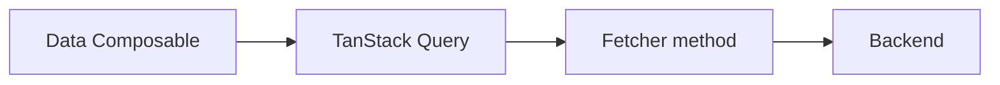

The data layer is where Ginjou reads and writes data.

This page focuses on fetchers, low-level composables, and the shared behaviors that sit underneath higher-level controllers.



## Fetcher Context

Fetcher context is where the app registers one or more fetchers.

Those fetchers follow the shared fetcher contract, and every query or mutation composable eventually calls one fetcher method.

### Interface

::code-group

```ts [Fetcher]
interface Fetcher<TRecord = any> {
	getList?: (props: {
		resource: string
		pagination?: { current: any, perPage: number }
		sorters?: Array<{ field: string, order: 'asc' | 'desc' }>
		filters?: unknown[]
		meta?: Record<string, any>
	}) => Promise<{ data: TRecord[], total: number }>

	getOne?: (props: {
		resource: string
		id: string | number
		meta?: Record<string, any>
	}) => Promise<{ data: TRecord }>

	getMany?: (props: {
		resource: string
		ids: Array<string | number>
		meta?: Record<string, any>
	}) => Promise<{ data: TRecord[] }>

	createOne?: (props: {
		resource: string
		params: Record<string, any>
		meta?: Record<string, any>
	}) => Promise<{ data: TRecord }>

	createMany?: (props: {
		resource: string
		params: Array<Record<string, any>>
		meta?: Record<string, any>
	}) => Promise<{ data: TRecord[] }>

	updateOne?: (props: {
		resource: string
		id: string | number
		params?: Record<string, any>
		meta?: Record<string, any>
	}) => Promise<{ data: TRecord }>

	updateMany?: (props: {
		resource: string
		ids: Array<string | number>
		params?: Record<string, any>
		meta?: Record<string, any>
	}) => Promise<{ data: TRecord[] }>

	deleteOne?: (props: {
		resource: string
		id: string | number
		params?: Record<string, any>
		meta?: Record<string, any>
	}) => Promise<{ data: TRecord }>

	deleteMany?: (props: {
		resource: string
		ids: Array<string | number>
		params?: Record<string, any>
		meta?: Record<string, any>
	}) => Promise<{ data: TRecord[] }>

	custom?: (props: {
		url: string
		method: 'get' | 'post' | 'put' | 'patch' | 'delete' | 'head' | 'options'
		query?: Record<string, any>
		payload?: Record<string, any>
		headers?: Record<string, any>
		meta?: Record<string, any>
	}) => Promise<{ data: TRecord }>
}
```

::

Custom requests can also carry `filters`, `sorters`, `query`, `headers`, and `payload`.

The exact translation is fetcher-specific. Use this shape when the endpoint is not a standard resource action but should still share Ginjou query keys, notifications, auth error handling, and realtime options.

::code-group
---
sync: guide-example
---

```ts [Vue]
import { useCustom } from '@ginjou/vue'
import { computed } from 'vue'

const searchQuery = useCustom({
	url: '/search/posts',
	method: 'get',
	filters: [
		{ field: 'status', operator: 'eq', value: 'published' },
	],
	sorters: [
		{ field: 'createdAt', order: 'desc' },
	],
	query: {
		q: keyword.value,
	},
	headers: {
		'X-Feature': 'advanced-search',
	},
})

const results = computed(() => searchQuery.record.value?.items ?? [])
```

```ts [Svelte]
import { useCustom } from '@ginjou/svelte'

const searchQuery = useCustom(() => ({
	url: '/search/posts',
	method: 'get',
	filters: [
		{ field: 'status', operator: 'eq', value: 'published' },
	],
	sorters: [
		{ field: 'createdAt', order: 'desc' },
	],
	query: {
		q: keyword,
	},
	headers: {
		'X-Feature': 'advanced-search',
	},
}))

const results = $derived(searchQuery.record?.items ?? [])
```

::

### Methods

| Method | Explanation | Composables |
| --- | --- | --- |
| getList | Read a collection | `useGetList`, `useGetInfiniteList` |
| getOne | Read one record | `useGetOne`, `useGetManyByOne` |
| getMany | Read many records by ids | `useGetMany` |
| createOne | Create one record | `useCreateOne` |
| createMany | Create many records | `useCreateMany` |
| updateOne | Update one record | `useUpdateOne` |
| updateMany | Update many records | `useUpdateMany` |
| deleteOne | Delete one record | `useDeleteOne` |
| deleteMany | Delete many records | `useDeleteMany` |
| custom | Handle non-CRUD read or write | `useCustom`, `useCustomMutation` |

Adapter support varies. Some backend packages implement only a subset of these methods.

You do not need to implement every method on day one.

Start with the methods your app really uses, then add more as pages need them.

::code-group
---
sync: guide-example
---

```ts [Vue]
import { defineFetchersContext } from '@ginjou/vue'

defineFetchersContext({
	default: {
		async getList({ resource }) {
			const response = await fetch(`/api/${resource}`)
			const data = await response.json()

			return {
				data,
				total: data.length,
			}
		},
		async getOne({ resource, id }) {
			const response = await fetch(`/api/${resource}/${id}`)

			return {
				data: await response.json(),
			}
		},
		async createOne({ resource, params }) {
			const response = await fetch(`/api/${resource}`, {
				method: 'POST',
				headers: { 'Content-Type': 'application/json' },
				body: JSON.stringify(params),
			})

			return {
				data: await response.json(),
			}
		},
		async updateOne({ resource, id, params }) {
			const response = await fetch(`/api/${resource}/${id}`, {
				method: 'PUT',
				headers: { 'Content-Type': 'application/json' },
				body: JSON.stringify(params),
			})

			return {
				data: await response.json(),
			}
		},
		async deleteOne({ resource, id }) {
			const response = await fetch(`/api/${resource}/${id}`, {
				method: 'DELETE',
			})

			return {
				data: await response.json(),
			}
		},
	},
})
```

```ts [Svelte]
import { defineFetchersContext } from '@ginjou/svelte'

defineFetchersContext({
	default: {
		async getList({ resource }) {
			const response = await fetch(`/api/${resource}`)
			const data = await response.json()

			return {
				data,
				total: data.length,
			}
		},
		async getOne({ resource, id }) {
			const response = await fetch(`/api/${resource}/${id}`)

			return {
				data: await response.json(),
			}
		},
		async createOne({ resource, params }) {
			const response = await fetch(`/api/${resource}`, {
				method: 'POST',
				headers: { 'Content-Type': 'application/json' },
				body: JSON.stringify(params),
			})

			return {
				data: await response.json(),
			}
		},
		async updateOne({ resource, id, params }) {
			const response = await fetch(`/api/${resource}/${id}`, {
				method: 'PUT',
				headers: { 'Content-Type': 'application/json' },
				body: JSON.stringify(params),
			})

			return {
				data: await response.json(),
			}
		},
		async deleteOne({ resource, id }) {
			const response = await fetch(`/api/${resource}/${id}`, {
				method: 'DELETE',
			})

			return {
				data: await response.json(),
			}
		},
	},
})
```

::

## Resource

`resource` names the record set.

`fetcherName` picks the data source.

Most calls only need `resource`. Add `fetcherName` when more than one backend is registered and a request should target a specific one.

::code-group
---
sync: guide-example
---

```ts [Vue]
import { useGetList, useGetOne, useUpdateOne } from '@ginjou/vue'

const postsList = useGetList({
	resource: 'posts',
})

const postDetail = useGetOne({
	resource: 'posts',
	id: 1,
})

const updatePost = useUpdateOne({
	resource: 'posts',
	id: 1,
})
```

```ts [Svelte]
import { useGetList, useGetOne, useUpdateOne } from '@ginjou/svelte'

const postsList = useGetList({
	resource: 'posts',
})

const postDetail = useGetOne({
	resource: 'posts',
	id: 1,
})

const updatePost = useUpdateOne({
	resource: 'posts',
	id: 1,
})
```

::

## Get List

`useGetList` reads a collection.

It returns a TanStack `useQuery` result.

| Extra | Meaning |
| --- | --- |
| `records` | Shortcut for the list records. |

::code-group
---
sync: guide-example
---

```vue [Vue]
<script setup lang="ts">
import { useGetList } from '@ginjou/vue'
import { computed } from 'vue'

const postsQuery = useGetList({
	resource: 'posts',
	pagination: {
		current: 1,
		perPage: 20,
	},
	sorters: [
		{ field: 'createdAt', order: 'desc' },
	],
	filters: [
		{ field: 'status', operator: 'eq', value: 'published' },
	],
})

const posts = computed(() => postsQuery.records.value ?? [])
const total = computed(() => postsQuery.data.value?.total ?? 0)
</script>
```

```svelte [Svelte]
<script lang="ts">
import { useGetList } from '@ginjou/svelte'

const postsQuery = useGetList({
	resource: 'posts',
	pagination: {
		current: 1,
		perPage: 20,
	},
	sorters: [
		{ field: 'createdAt', order: 'desc' },
	],
	filters: [
		{ field: 'status', operator: 'eq', value: 'published' },
	],
})

const posts = $derived(postsQuery.records ?? [])
const total = $derived(postsQuery.data?.total ?? 0)
</script>
```

::

`useGetInfiniteList` also uses `fetcher.getList`. The difference is the TanStack Query mode.

It returns a TanStack `useInfiniteQuery` result.

| Extra | Meaning |
| --- | --- |
| `records` | Loaded records grouped by page. |

::code-group
---
sync: guide-example
---

```vue [Vue]
<script setup lang="ts">
import { useGetInfiniteList } from '@ginjou/vue'
import { computed } from 'vue'

const feedQuery = useGetInfiniteList({
	resource: 'posts',
	pagination: {
		current: 1,
		perPage: 20,
	},
})

const pages = computed(() => feedQuery.records.value ?? [])
const flatPosts = computed(() => pages.value.flat())
</script>
```

```svelte [Svelte]
<script lang="ts">
import { useGetInfiniteList } from '@ginjou/svelte'

const feedQuery = useGetInfiniteList({
	resource: 'posts',
	pagination: {
		current: 1,
		perPage: 20,
	},
})

const pages = $derived(feedQuery.records ?? [])
const flatPosts = $derived(pages.flat())
</script>
```

::

### `filters`

Filters are a tree.

Use one rule for simple cases. Use `and` or `or` when the backend query needs grouped conditions.

Conditional Operator:

| Operator | Explanation |
| --- | --- |
| `and` | All child filters must match. |
| `or` | Any child filter can match. |

Logical Operator

| Operator | Explanation |
| --- | --- |
| `eq` | Equal to the value. |
| `ne` | Not equal to the value. |
| `lt` | Less than the value. |
| `gt` | Greater than the value. |
| `lte` | Less than or equal to the value. |
| `gte` | Greater than or equal to the value. |
| `in` | Match a value in a list. |
| `nin` | Exclude a value in a list. |
| `contains` | Text contains the value. |
| `ncontains` | Text does not contain the value. |
| `containss` | Case-sensitive contains. |
| `ncontainss` | Case-sensitive not contains. |
| `startswith` | Text starts with the value. |
| `nstartswith` | Text does not start with the value. |
| `startswiths` | Case-sensitive starts with. |
| `nstartswiths` | Case-sensitive not starts with. |
| `endswith` | Text ends with the value. |
| `nendswith` | Text does not end with the value. |
| `endswiths` | Case-sensitive ends with. |
| `nendswiths` | Case-sensitive not ends with. |
| `between` | Match a range. |
| `nbetween` | Exclude a range. |
| `null` | Value is null. |
| `nnull` | Value is not null. |

::code-group
---
sync: guide-example
---

```ts [Vue]
import { useGetList } from '@ginjou/vue'

const postsQuery = useGetList({
	resource: 'posts',
	filters: [
		{ field: 'status', operator: 'eq', value: 'published' },
		{
			operator: 'or',
			value: [
				{ field: 'title', operator: 'contains', value: keyword.value },
				{ field: 'summary', operator: 'contains', value: keyword.value },
			],
		},
	],
})
```

```ts [Svelte]
import { useGetList } from '@ginjou/svelte'

const postsQuery = useGetList(() => ({
	resource: 'posts',
	filters: [
		{ field: 'status', operator: 'eq', value: 'published' },
		{
			operator: 'or',
			value: [
				{ field: 'title', operator: 'contains', value: keyword },
				{ field: 'summary', operator: 'contains', value: keyword },
			],
		},
	],
}))
```

::

### `sorters`

Sorters are an ordered array.

The first sorter is the primary sort. The rest act as tie-breakers.

::code-group
---
sync: guide-example
---

```ts [Vue]
import { useGetList } from '@ginjou/vue'

const postsQuery = useGetList({
	resource: 'posts',
	sorters: [
		{ field: 'createdAt', order: 'desc' },
		{ field: 'id', order: 'desc' },
	],
})
```

```ts [Svelte]
import { useGetList } from '@ginjou/svelte'

const postsQuery = useGetList({
	resource: 'posts',
	sorters: [
		{ field: 'createdAt', order: 'desc' },
		{ field: 'id', order: 'desc' },
	],
})
```

::

### `pagination`

Pagination always uses `current` and `perPage`.

`current` can be a page number or another page token, depending on what the fetcher expects.

Page number example:

::code-group
---
sync: guide-example
---

```vue [Vue]
<script setup lang="ts">
import { useGetList } from '@ginjou/vue'

const postsQuery = useGetList({
	resource: 'posts',
	pagination: {
		current: 3,
		perPage: 20,
	},
})
</script>
```

```svelte [Svelte]
<script lang="ts">
import { useGetList } from '@ginjou/svelte'

const postsQuery = useGetList({
	resource: 'posts',
	pagination: {
		current: 3,
		perPage: 20,
	},
})
</script>
```

::

Cursor example:

::code-group
---
sync: guide-example
---

```vue [Vue]
<script setup lang="ts">
import { useGetInfiniteList } from '@ginjou/vue'

const feedQuery = useGetInfiniteList({
	resource: 'posts',
	pagination: {
		current: 'cursor:0',
		perPage: 20,
	},
})
</script>
```

```svelte [Svelte]
<script lang="ts">
import { useGetInfiniteList } from '@ginjou/svelte'

const feedQuery = useGetInfiniteList({
	resource: 'posts',
	pagination: {
		current: 'cursor:0',
		perPage: 20,
	},
})
</script>
```

::

## Get One

`useGetOne` reads one record.

It returns a TanStack `useQuery` result.

| Extra | Meaning |
| --- | --- |
| `record` | Shortcut for the single record. |

::code-group
---
sync: guide-example
---

```vue [Vue]
<script setup lang="ts">
import { useGetOne } from '@ginjou/vue'

const postQuery = useGetOne({
	resource: 'posts',
	id: 1,
})
</script>

<template>
	<div v-if="postQuery.isLoading">
		Loading...
	</div>
	<div v-else-if="postQuery.isError">
		Failed to load.
	</div>
	<article v-else-if="postQuery.record">
		<h1>{{ postQuery.record.title }}</h1>
	</article>
</template>
```

```svelte [Svelte]
<script lang="ts">
import { useGetOne } from '@ginjou/svelte'

const postQuery = useGetOne({
	resource: 'posts',
	id: 1,
})
</script>

{#if postQuery.isLoading}
	Loading...
{:else if postQuery.isError}
	Failed to load.
{:else if postQuery.record}
	<article>
		<h1>{postQuery.record.title}</h1>
	</article>
{/if}
```

::

## Get Many

`useGetMany` reads many records from known ids.

If `fetcher.getMany` is missing, Ginjou falls back to repeated `fetcher.getOne`. Records whose `getOne` fails with a 404 (`status`, `statusCode`, or `response.status`) are left out of the result, matching a `getMany` that returns only existing records; any other error fails the query.

It returns a TanStack `useQuery` result.

| Extra | Meaning |
| --- | --- |
| `records` | Shortcut for the returned records. |

::code-group
---
sync: guide-example
---

```ts [Vue]
import { useGetMany, useGetOne } from '@ginjou/vue'
import { computed } from 'vue'

const postQuery = useGetOne({
	resource: 'posts',
	id: 1,
})

const commentsQuery = useGetMany({
	resource: 'comments',
	ids: computed(() => postQuery.record.value?.commentIds ?? []),
})

const comments = computed(() => commentsQuery.records.value ?? [])
```

```ts [Svelte]
import { useGetMany, useGetOne } from '@ginjou/svelte'

const postQuery = useGetOne({
	resource: 'posts',
	id: 1,
})

const commentsQuery = useGetMany(() => ({
	resource: 'comments',
	ids: postQuery.record?.commentIds ?? [],
}))

const comments = $derived(commentsQuery.records ?? [])
```

::

## Get Many by One

`useGetManyByOne` reads many records from known ids.

It runs one `getOne` query for each id and combines those results into one TanStack `useQuery` result.

Use it when the same related record can appear in multiple places, such as users shared across posts, and existing `getOne` cache entries can be reused. Unlike `useGetMany`, it does not call `fetcher.getMany`.

`queryOptions` can also be a function. Ginjou calls it for each id with `{ id, index }` and uses the returned value as that record's `getOne` query options.

| Extra | Meaning |
| --- | --- |
| `records` | Shortcut for the returned records. |

::code-group
---
sync: guide-example
---

```ts [Vue]
import { useGetList, useGetManyByOne } from '@ginjou/vue'
import { computed } from 'vue'

const postsQuery = useGetList<{
	id: string
	title: string
	userId: string
}>({
	resource: 'posts',
})

const userIds = computed(() =>
	Array.from(
		new Set((postsQuery.records.value ?? []).map(post => post.userId)),
	),
)

const usersQuery = useGetManyByOne<{
	id: string
	name: string
}>({
	resource: 'users',
	ids: userIds,
	queryOptions: ({ index }) => ({
		staleTime: index === 0 ? 60_000 : 5_000,
	}),
})

const users = computed(() => usersQuery.records.value ?? [])
```

```ts [Svelte]
import { useGetList, useGetManyByOne } from '@ginjou/svelte'

const postsQuery = useGetList<{
	id: string
	title: string
	userId: string
}>({
	resource: 'posts',
})

const userIds = $derived(
	Array.from(
		new Set((postsQuery.records ?? []).map(post => post.userId)),
	),
)

const usersQuery = useGetManyByOne<{
	id: string
	name: string
}>(() => ({
	resource: 'users',
	ids: userIds,
	queryOptions: ({ index }) => ({
		staleTime: index === 0 ? 60_000 : 5_000,
	}),
}))

const users = $derived(usersQuery.records ?? [])
```

::

## Custom Query

`useCustom` is for read endpoints that do not fit CRUD.

Use it for reports, stats, or search endpoints.

It returns a TanStack `useQuery` result.

| Extra | Meaning |
| --- | --- |
| `record` | Shortcut for the returned data record. |

::code-group
---
sync: guide-example
---

```ts [Vue]
import { useCustom } from '@ginjou/vue'
import { computed } from 'vue'

const reportQuery = useCustom({
	url: '/reports/monthly',
	method: 'get',
	query: {
		month: selectedMonth.value,
	},
})

const report = computed(() => reportQuery.record.value)
```

```ts [Svelte]
import { useCustom } from '@ginjou/svelte'

const reportQuery = useCustom(() => ({
	url: '/reports/monthly',
	method: 'get',
	query: {
		month: selectedMonth,
	},
}))

const report = $derived(reportQuery.record)
```

::

## Query Options

`queryOptions` comes from TanStack Query.

Use it for `enabled`, callbacks, `placeholderData`, retry, and other [TanStack Query](https://tanstack.com/query/latest/docs) settings.

::code-group
---
sync: guide-example
---

```ts [Vue]
import { useGetOne } from '@ginjou/vue'
import { computed } from 'vue'

const postId = computed(() => route.params.id)

const postQuery = useGetOne({
	resource: 'posts',
	id: postId,
	queryOptions: {
		enabled: computed(() => postId.value != null && postId.value !== ''),
		onSuccess: () => {
			isDrawerOpen.value = true
		},
	},
})
```

```ts [Svelte]
import { useGetOne } from '@ginjou/svelte'

const postQuery = useGetOne(() => ({
	resource: 'posts',
	id: route.params.id,
	queryOptions: {
		enabled: () => route.params.id != null && route.params.id !== '',
		onSuccess: () => {
			isDrawerOpen = true
		},
	},
}))
```

::

## Create One

`useCreateOne` creates one record.

It returns TanStack `useMutation` result.

| Extra | Meaning |
| --- | --- |
| `mutate` | Sync-style trigger with Ginjou mutation props. |
| `mutateAsync` | Promise-style trigger with Ginjou mutation props. |

::code-group
---
sync: guide-example
---

```ts [Vue]
import { useCreateOne } from '@ginjou/vue'

const createPost = useCreateOne({
	resource: 'posts',
})

await createPost.mutateAsync({
	params: {
		title: 'Hello Ginjou',
		status: 'draft',
	},
})
```

```ts [Svelte]
import { useCreateOne } from '@ginjou/svelte'

const createPost = useCreateOne({
	resource: 'posts',
})

await createPost.mutateAsync({
	params: {
		title: 'Hello Ginjou',
		status: 'draft',
	},
})
```

::

## Create Many

`useCreateMany` creates many records.

If `fetcher.createMany` is missing, Ginjou falls back to repeated `fetcher.createOne`.

It returns TanStack `useMutation` result.

| Extra | Meaning |
| --- | --- |
| `mutate` | Sync-style trigger with Ginjou mutation props. |
| `mutateAsync` | Promise-style trigger with Ginjou mutation props. |

::code-group
---
sync: guide-example
---

```ts [Vue]
import { useCreateMany } from '@ginjou/vue'

const createPosts = useCreateMany({
	resource: 'posts',
})

await createPosts.mutateAsync({
	params: csvRows.value.map(row => ({
		title: row.title,
		status: 'draft',
	})),
})
```

```ts [Svelte]
import { useCreateMany } from '@ginjou/svelte'

const createPosts = useCreateMany({
	resource: 'posts',
})

await createPosts.mutateAsync({
	params: csvRows.map(row => ({
		title: row.title,
		status: 'draft',
	})),
})
```

::

## Mutation Mode

`mutationMode` controls when update and delete feel committed.

Choose it based on the UX promise of the page, not just on backend speed.

| Mode | Meaning | Composables |
| --- | --- | --- |
| pessimistic | wait for the server | `useUpdateOne`, `useUpdateMany`, `useDeleteOne`, `useDeleteMany` |
| optimistic | update cache first | `useUpdateOne`, `useUpdateMany`, `useDeleteOne`, `useDeleteMany` |
| undoable | wait for a timeout before the real request | `useUpdateOne`, `useUpdateMany`, `useDeleteOne`, `useDeleteMany` |

### `pessimistic`

Use this when the UI should only change after the server confirms success.

::code-group
---
sync: guide-example
---

```vue [Vue]
<script setup lang="ts">
import { useUpdateOne } from '@ginjou/vue'

const updatePost = useUpdateOne({
	resource: 'posts',
	id: 1,
	mutationMode: 'pessimistic',
})
</script>
```

```svelte [Svelte]
<script lang="ts">
import { useUpdateOne } from '@ginjou/svelte'

const updatePost = useUpdateOne({
	resource: 'posts',
	id: 1,
	mutationMode: 'pessimistic',
})
</script>
```

::

### `optimistic`

Use this when the UI should feel immediate and you can tolerate rollback if the request fails.

::code-group
---
sync: guide-example
---

```vue [Vue]
<script setup lang="ts">
import { useUpdateOne } from '@ginjou/vue'

const updatePost = useUpdateOne({
	resource: 'posts',
	id: 1,
	mutationMode: 'optimistic',
})
</script>
```

```svelte [Svelte]
<script lang="ts">
import { useUpdateOne } from '@ginjou/svelte'

const updatePost = useUpdateOne({
	resource: 'posts',
	id: 1,
	mutationMode: 'optimistic',
})
</script>
```

::

### `undoable`

The default undoable timeout is 5000 ms.

Use this when users should get a short window to cancel destructive actions.

::code-group
---
sync: guide-example
---

```vue [Vue]
<script setup lang="ts">
import { useDeleteOne } from '@ginjou/vue'

const deletePost = useDeleteOne({
	resource: 'posts',
	id: 1,
	mutationMode: 'undoable',
	undoableTimeout: 8000,
})
</script>
```

```svelte [Svelte]
<script lang="ts">
import { useDeleteOne } from '@ginjou/svelte'

const deletePost = useDeleteOne({
	resource: 'posts',
	id: 1,
	mutationMode: 'undoable',
	undoableTimeout: 8000,
})
</script>
```

::

### `optimisticUpdate`

In `optimistic` and `undoable` modes, Ginjou updates cached `list`, `many`, and `one` queries before the server response settles.

Use `optimisticUpdate` when you need to skip or customize those cache updates.

| Value | Meaning |
| --- | --- |
| `true` or omitted | Use Ginjou's default cache updater. |
| `false` | Skip that cache group. |
| function | Return the next cached query data yourself. |

Update functions receive `(previous, params, target)`. For `list` and `many`, `target` is the `id` or `ids` passed to the mutation. For `one`, `target` is always a single id.

::code-group
---
sync: guide-example
---

```ts [Vue]
import { useUpdateOne } from '@ginjou/vue'

const updatePost = useUpdateOne({
	resource: 'posts',
	id: 1,
	mutationMode: 'optimistic',
	optimisticUpdate: {
		list: false,
		many: true,
		one(previous, params, id) {
			if (!previous)
				return

			return {
				...previous,
				data: {
					...previous.data,
					...params,
					id,
					previewTitle: params.title,
				},
			}
		},
	},
})
```

```ts [Svelte]
import { useUpdateOne } from '@ginjou/svelte'

const updatePost = useUpdateOne({
	resource: 'posts',
	id: 1,
	mutationMode: 'optimistic',
	optimisticUpdate: {
		list: false,
		many: true,
		one(previous, params, id) {
			if (!previous)
				return

			return {
				...previous,
				data: {
					...previous.data,
					...params,
					id,
					previewTitle: params.title,
				},
			}
		},
	},
})
```

::

## Update One

`useUpdateOne` updates one record.

It returns TanStack `useMutation` result.

| Extra | Meaning |
| --- | --- |
| `mutate` | Sync-style trigger with Ginjou mutation props. |
| `mutateAsync` | Promise-style trigger with Ginjou mutation props. |

::code-group
---
sync: guide-example
---

```ts [Vue]
import { useUpdateOne } from '@ginjou/vue'

const publishPost = useUpdateOne({
	resource: 'posts',
	id: 1,
	mutationMode: 'optimistic',
})

await publishPost.mutateAsync({
	params: {
		status: 'published',
	},
})
```

```ts [Svelte]
import { useUpdateOne } from '@ginjou/svelte'

const publishPost = useUpdateOne({
	resource: 'posts',
	id: 1,
	mutationMode: 'optimistic',
})

await publishPost.mutateAsync({
	params: {
		status: 'published',
	},
})
```

::

## Update Many

`useUpdateMany` updates many records.

If `fetcher.updateMany` is missing, Ginjou falls back to repeated `fetcher.updateOne`.

It returns TanStack `useMutation` result.

| Extra | Meaning |
| --- | --- |
| `mutate` | Sync-style trigger with Ginjou mutation props. |
| `mutateAsync` | Promise-style trigger with Ginjou mutation props. |

::code-group
---
sync: guide-example
---

```ts [Vue]
import { useUpdateMany } from '@ginjou/vue'

const publishPosts = useUpdateMany({
	resource: 'posts',
	mutationMode: 'optimistic',
})

await publishPosts.mutateAsync({
	ids: selectedIds.value,
	params: {
		status: 'published',
	},
})
```

```ts [Svelte]
import { useUpdateMany } from '@ginjou/svelte'

const publishPosts = useUpdateMany({
	resource: 'posts',
	mutationMode: 'optimistic',
})

await publishPosts.mutateAsync({
	ids: selectedIds,
	params: {
		status: 'published',
	},
})
```

::

## Delete One

`useDeleteOne` deletes one record.

It returns TanStack `useMutation` result.

| Extra | Meaning |
| --- | --- |
| `mutate` | Sync-style trigger with Ginjou mutation props. |
| `mutateAsync` | Promise-style trigger with Ginjou mutation props. |

::code-group
---
sync: guide-example
---

```ts [Vue]
import { useDeleteOne } from '@ginjou/vue'

const deletePost = useDeleteOne({
	resource: 'posts',
	id: 1,
	mutationMode: 'undoable',
})

deletePost.mutate()
```

```ts [Svelte]
import { useDeleteOne } from '@ginjou/svelte'

const deletePost = useDeleteOne({
	resource: 'posts',
	id: 1,
	mutationMode: 'undoable',
})

deletePost.mutate()
```

::

## Delete Many

`useDeleteMany` deletes many records.

If `fetcher.deleteMany` is missing, Ginjou falls back to repeated `fetcher.deleteOne`.

It returns TanStack `useMutation` result.

| Extra | Meaning |
| --- | --- |
| `mutate` | Sync-style trigger with Ginjou mutation props. |
| `mutateAsync` | Promise-style trigger with Ginjou mutation props. |

::code-group
---
sync: guide-example
---

```ts [Vue]
import { useDeleteMany } from '@ginjou/vue'

const deletePosts = useDeleteMany({
	resource: 'posts',
	mutationMode: 'undoable',
})

await deletePosts.mutateAsync({
	ids: selectedIds.value,
})
```

```ts [Svelte]
import { useDeleteMany } from '@ginjou/svelte'

const deletePosts = useDeleteMany({
	resource: 'posts',
	mutationMode: 'undoable',
})

await deletePosts.mutateAsync({
	ids: selectedIds,
})
```

::

## Custom Mutation

`useCustomMutation` is for write actions that do not fit CRUD.

It does not bring CRUD invalidation presets or mutationMode.

It returns TanStack `useMutation` result.

| Extra | Meaning |
| --- | --- |
| `mutate` | Sync-style trigger with Ginjou mutation props. |
| `mutateAsync` | Promise-style trigger with Ginjou mutation props. |

::code-group
---
sync: guide-example
---

```ts [Vue]
import { useCustomMutation } from '@ginjou/vue'

const publishPost = useCustomMutation({
	url: '/posts/1/publish',
	method: 'post',
})

await publishPost.mutateAsync()
```

```ts [Svelte]
import { useCustomMutation } from '@ginjou/svelte'

const publishPost = useCustomMutation({
	url: '/posts/1/publish',
	method: 'post',
})

await publishPost.mutateAsync()
```

::

## Mutation Options

`mutationOptions` also comes from TanStack Query.

Use it for callbacks and lifecycle control. For details, read the [TanStack Query](https://tanstack.com/query/latest/docs).

::code-group
---
sync: guide-example
---

```ts [Vue]
import { useUpdateOne } from '@ginjou/vue'

const updatePost = useUpdateOne({
	resource: 'posts',
	id: 1,
	mutationOptions: {
		onSuccess: () => {
			isEditorOpen.value = false
		},
	},
})
```

```ts [Svelte]
import { useUpdateOne } from '@ginjou/svelte'

const updatePost = useUpdateOne({
	resource: 'posts',
	id: 1,
	mutationOptions: {
		onSuccess: () => {
			isEditorOpen = false
		},
	},
})
```

::

## Multiple Fetchers

You can register more than one fetcher.

Use `fetcherName` to choose the source. If you omit it, Ginjou uses `default`.

::code-group
---
sync: guide-example
---

```ts [Vue]
import { defineFetchersContext, useGetList } from '@ginjou/vue'

defineFetchersContext({
	default: restFetcher,
	legacy: legacyFetcher,
})

const currentPosts = useGetList({
	resource: 'posts',
})

const legacyPosts = useGetList({
	resource: 'posts',
	fetcherName: 'legacy',
})
```

```ts [Svelte]
import { defineFetchersContext, useGetList } from '@ginjou/svelte'

defineFetchersContext({
	default: restFetcher,
	legacy: legacyFetcher,
})

const currentPosts = useGetList({
	resource: 'posts',
})

const legacyPosts = useGetList({
	resource: 'posts',
	fetcherName: 'legacy',
})
```

::

## Auth Error Handling

Built-in query and mutation composables already call `auth.checkError`.

That means most pages do not need to wire auth error handling by hand unless they are making custom requests outside the standard hooks.

## Cache Invalidation

`invalidates` controls which cached queries should refresh after a mutation. Create mutations invalidate only after success; update and delete mutations invalidate once they settle, after success **or** failure.

Targets are `all`, `resource`, `list`, `many`, and `one`. `all` invalidates every query of a single fetcher, not every fetcher.

`'one'` and `'many'` work on the affected IDs passed as `ids` in the invalidate context. Mutations pass them for you: the mutation's `id` / `ids` plus every ID in the result. `'one'` refreshes every one query of those IDs, and `'many'` refreshes every many query whose `ids` include one of them, whatever `meta` the queries were fetched with. Without `ids` the rule is skipped with a `console.warn`; outside a mutation pass them yourself, as in `invalidate({ resource: 'posts', invalidates: ['one'] }, { ids: [1] })`.

Default invalidates:

| Composable | Default invalidates | Runs |
| --- | --- | --- |
| `useCreateOne` | list | on success |
| `useCreateMany` | list | on success |
| `useUpdateOne` | list, many, one | on settled |
| `useUpdateMany` | list, many, one | on settled |
| `useDeleteOne` | list, many | on settled |
| `useDeleteMany` | list, many | on settled |

Create mutations skip `'many'` by default: a new record's ID can't be in a many query fetched before it existed. If your app requests an ID before creating it (for example a client-generated UUID), add it back with `invalidates: ['list', 'many']`.

::code-group
---
sync: guide-example
---

```ts [Vue]
import { useUpdateOne } from '@ginjou/vue'

const updatePost = useUpdateOne({
	resource: 'posts',
	id: 1,
	invalidates: ['one', 'list'],
})
```

```ts [Svelte]
import { useUpdateOne } from '@ginjou/svelte'

const updatePost = useUpdateOne({
	resource: 'posts',
	id: 1,
	invalidates: ['one', 'list'],
})
```

::

Passing `invalidates` replaces the defaults, so list the defaults you still want next to the extra rules:

```ts
const updatePost = useUpdateOne({
	resource: 'posts',
	id: 1,
	invalidates: [
		'list',
		'many',
		'one',
		{ target: 'resource', resource: 'comments' },
		{ target: 'one', resource: 'authors', id: 1 },
		{ target: 'all', fetcherName: 'legacy' },
	],
})
```

`invalidates` can also be a callback. It receives the invalidate context `{ ids, data }`: `ids` the affected IDs and `data` the mutation result. It does not receive the defaults or the mutation props; to invalidate based on the variables you passed to `mutate`, create the invalidator with `useQueryInvalidate()` during setup and call it from that call's `onSuccess`, as in `mutate(vars, { onSuccess: () => invalidate({ resource: 'authors', invalidates: [{ target: 'one', id: vars.params.authorId }] }) })`. Use `data` to target related records the server returned, such as a comment's parent post:

```ts
const createComment = useCreateOne({
	resource: 'comments',
	invalidates: ({ data }) => [
		'list',
		...(data?.data.postId != null ? [{ target: 'one' as const, resource: 'posts', id: data.data.postId }] : []),
	],
})
```

For update and delete mutations the callback also runs when the mutation fails, with `data` set to `undefined`, so guard it as above. Create mutations never call it on failure. Every rule must be valid: Ginjou checks all rules before invalidating anything, so one invalid rule (for example `{ target: 'one', id: undefined }`) cancels the whole invalidation, including `'list'`. Only add a rule once its ID is known, as the example does. An error thrown while invalidating (for example from the callback) does not fail the mutation; it is logged with `console.error` and that invalidation is skipped.

To tune how TanStack Query refetches, pass an object with `rules` plus `filters` and `options`. Each one replaces its default (`{ type: 'all', refetchType: 'active' }` and `{ cancelRefetch: false }`) entirely, so include any default fields you still want. A callback can return this form too:

```ts
const updatePost = useUpdateOne({
	resource: 'posts',
	id: 1,
	invalidates: {
		rules: ['list', 'one'],
		filters: { refetchType: 'all' },
		options: { cancelRefetch: true },
	},
})
```

Object rules use the mutation's `fetcherName` when omitted. Without `meta` they match queries of any `meta`; with `meta` they match only that exact `meta`. `filters` is spread over each rule's own filters, so its fields win for every rule: a `predicate` replaces the ID and `meta` matching of `'one'` rules, string `'many'` rules, and object `'many'` rules without `meta` (an object `'many'` rule with `meta` matches its exact key, so a `predicate` only narrows it further), and `exact: true` turns the key-prefix match of every rule into an exact match, which usually matches nothing. Only set them when you mean to override the rule's own matching. Use `useQueryInvalidate` outside a mutation:

```ts
import { useQueryInvalidate } from '@ginjou/vue' // or @ginjou/svelte

const invalidate = useQueryInvalidate()

await invalidate({
	invalidates: [{
		target: 'resource',
		resource: 'comments',
	}],
})
```

## Notifications

Query and mutation composables can show default success and error messages.

Use `successNotify` or `errorNotify` to replace them. Use `false` to disable them.

## Realtime

When realtime is enabled, query composables subscribe and standard mutation composables publish.

The default channel is `resources/{resource}`. `useCustom` and `useCustomMutation` can use their own channel or event.

## Meta

`meta` is the backend-specific extension point.

Ginjou forwards it to the fetcher and includes it in query keys. Use it for backend details that do not belong in the shared contract. Keep it small, and read the backend guides for the exact shape.

For example, the REST adapter forwards `meta.method` and `meta.headers` to standard resource requests.

::code-group
---
sync: guide-example
---

```ts [Vue]
import { useGetList } from '@ginjou/vue'

const postsQuery = useGetList({
	resource: 'posts',
	meta: {
		method: 'POST',
		headers: {
			'X-Tenant': 'team-a',
		},
	},
})
```

```ts [Svelte]
import { useGetList } from '@ginjou/svelte'

const postsQuery = useGetList({
	resource: 'posts',
	meta: {
		method: 'POST',
		headers: {
			'X-Tenant': 'team-a',
		},
	},
})
```

::

The Supabase adapter uses `meta.select`, `meta.count`, and `meta.idColumnName`.

::code-group
---
sync: guide-example
---

```ts [Vue]
import { useGetMany } from '@ginjou/vue'

const ordersQuery = useGetMany({
	resource: 'orders',
	ids: ['order-001', 'order-002'],
	meta: {
		idColumnName: 'order_id',
		select: 'order_id,total,customer:customers(id,name)',
	},
})
```

```ts [Svelte]
import { useGetMany } from '@ginjou/svelte'

const ordersQuery = useGetMany({
	resource: 'orders',
	ids: ['order-001', 'order-002'],
	meta: {
		idColumnName: 'order_id',
		select: 'order_id,total,customer:customers(id,name)',
	},
})
```

::
